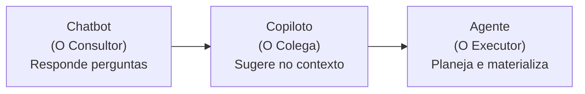

# 🚀 Potencializando Estudos e Carreira com IA

> **Bootcamp Itaú & DIO** — *Documentação consolidada dos aprendizados, fundamentos teóricos de Inteligência Artificial e da jornada prática de transição de carreira utilizando IA (Chatbots, Copilotos e Agentes).*

---

## 📋 Sumário
1. [Sobre o Projeto](#-sobre-o-projeto)
2. [Fundamentos Teóricos de Inteligência Artificial](#-fundamentos-teóricos-de-inteligência-artificial)
   - [A Era das IAs Generativas](#a-era-das-ias-generativas)
   - [Como Treinar uma IA, Tokens e LLMs](#como-treinar-uma-ia-tokens-e-llms)
   - [Machine Learning vs. Deep Learning](#machine-learning-vs-deep-learning)
3. [A Jornada Prática: Os Três Níveis de Interação](#-a-jornada-prática-os-três-níveis-de-interação)
   - [Nível 1: Chatbot (O Consultor) & Direcionamento de Carreira](#nível-1-chatbot-o-consultor--direcionamento-de-carreira)
   - [Nível 2: Copiloto (O Colega de Trabalho) & Plano de Estudos](#nível-2-copiloto-o-colega-de-trabalho--plano-de-estudos)
   - [Nível 3: Agente (O Executor Autônomo) & Workspace](#nível-3-agente-o-executor-autônomo--workspace)
4. [Ecossistema de Ferramentas de IA](#-ecossistema-de-ferramentas-de-ia)
5. [Estrutura do Repositório](#-estrutura-do-repositório)
6. [Passo 3: Como Revisar e Próximos Passos](#-passo-3-como-revisar-e-próximos-passos)

---

## 🎯 Sobre o Projeto

Este repositório reúne os conceitos, reflexões e materiais desenvolvidos durante o treinamento do **Bootcamp do Itaú** em parceria com a **DIO**. O objetivo principal é capacitar o profissional no uso estratégico de Inteligências Artificiais Generativas para acelerar o aprendizado contínuo e potencializar o desenvolvimento de carreira em tecnologia.

---

## 🧠 Fundamentos Teóricos de Inteligência Artificial

### A Era das IAs Generativas
Diferente dos modelos preditivos clássicos focados apenas em classificar ou prever números/categorias pré-existentes, as **IAs Generativas (GenAI)** foram desenvolvidas para **criar conteúdos novos do zero** (textos, imagens, áudios, vídeos e códigos). Modelos como ChatGPT e Gemini interpretam instruções contextuais e geram respostas e criações complexas sem necessidade de armazenamento estático de imagens ou dados fixos.

### Como Treinar uma IA, Tokens e LLMs
O aprendizado de uma IA não funciona como uma câmera fotográfica (que grava os pixels exatos na memória), mas sim como o **cérebro humano**:
* **Reconhecimento de Padrões e Parâmetros:** O modelo identifica atributos invariantes (ex.: forma esferoidal, cavidade apical/peduncular, texturas e cores de uma maçã).
* **Tokens e Vetores:** A informação bruta é decomposta em unidades fundamentais (*tokens*), convertidas em parâmetros matemáticos.
* **Reforço Positivo (RLHF / Feedback):** A calibragem ocorre via reforço (likes/dislikes e justificativas de erro) para ensinar ao modelo o porquê de um objeto atípico (uma maçã achatada ou com folhas) ainda pertencer àquela categoria.
* **Cálculo Probabilístico:** A inferência é uma função de probabilidade matemática baseada no agrupamento semântico dos atributos reconhecidos.
* **LLMs (Large Language Models):** Modelos alimentados com bilhões de parâmetros e vasto repertório textual e conceitual, permitindo compreensão semântica aprofundada em contextos gerais ou específicos.

### Machine Learning vs. Deep Learning
O avanço do **Deep Learning (DL)** viabilizou a era das **IAs Multimodais**:

| Característica | Machine Learning Tradicional (ML) | Deep Learning (DL) |
| :--- | :--- | :--- |
| **Extração de Características** | Humana (manual): o especialista extrai cor, forma e textura | Automática: a rede neural extrai representações dos dados brutos |
| **Arquitetura** | Algoritmos estatísticos (árvores de decisão, SVM, regressão) | Redes Neurais Artificiais profundas com múltiplas camadas |
| **Conexões Semânticas** | Limitada a correlações diretas entre variáveis tabulares | Mapeia redes conceituais (ex: filme de terror $\to$ susto $\to$ elenco $\to$ recomendação) |
| **Multimodalidade** | Predominantemente dados estruturados/unimodais | Processa e correlaciona texto, áudio, imagens e vídeo conjuntamente |

---

## 🧭 A Jornada Prática: Os Três Níveis de Interação

Durante o treinamento, foi percorrida uma jornada prática progressiva demonstrando a evolução das interações com IA:

### Nível 1: Chatbot (O Consultor) & Direcionamento de Carreira
* **Conceito:** O chatbot é um consultor sob demanda. A qualidade da resposta é diretamente proporcional à clareza e ao contexto fornecido no *prompt*.
* **Prática Realizada:** Simulação de transição de carreira para a área de tecnologia dispondo de 1 hora de estudo diária, aproveitando histórico profissional prévio em Segurança Pública.
* **Decisão Estratégica:**
  * **Área Selecionada:** **Cibersegurança (Segurança da Informação)**, aproveitando diferenciais de gestão de risco, atenção a detalhes, resolução analítica de problemas e ética defensiva.
  * **5 Tópicos Iniciais Mapeados:**
    1. *Fundamentos de Redes de Computadores* (TCP/IP, portas, DNS, protocolos HTTP/HTTPS).
    2. *Sistemas Operacionais* (fundamentos de Linux e linha de comando terminal).
    3. *Fundamentos de Segurança e Ameaças* (malwares, phishing, criptografia, IAM).
    4. *Legislação e Governança* (LGPD e normas ISO 27001).
    5. *Laboratórios Práticos* (plataformas hands-on como TryHackMe e Hack The Box).

### Nível 2: Copiloto (O Colega de Trabalho) & Plano de Estudos
* **Conceito:** Diferente do chatbot (que conhece apenas a janela de chat atual), o copiloto atua em tempo real integrado às suas ferramentas de trabalho (Google Docs, IDEs, etc.), consumindo o contexto existente (documentos, emails e arquivos) de forma segura.
* **Prática Realizada:** Criação e refinamento colaborativo de um cronograma de estudos de 30 dias distribuindo os 5 tópicos em 4 semanas estruturadas, ajustando tom e clareza em tempo real.

### Nível 3: Agente (O Executor Autônomo) & Workspace
* **Conceito:** O agente atua por delegação de confiança. O usuário define o objetivo de alto nível e o agente analisa o cenário, elabora as etapas, seleciona as ferramentas e executa o trabalho no workspace real.
* **Prática Realizada:** Execução da materialização do repositório no Google Antigravity, organizando anotações, estruturando o `README.md` e estabelecendo a base de trabalho local.

---

## 🛠️ Ecossistema de Ferramentas de IA

| Categoria | Descrição | Principais Ferramentas |
| :--- | :--- | :--- |
| **Chatbots** | Consultores conversacionais para dúvidas, ideação e sínteses | ChatGPT, Claude, Microsoft Copilot, Google Gemini |
| **Copilotos** | Assistentes de fluxo contínuo integrados em editores e ferramentas | Gemini no Google Docs/Drive, Notion AI, GitHub Copilot |
| **Agentes** | Executores autônomos de tarefas complexas no ambiente local/nuvem | Google Antigravity, Claude Code, Cursor, OpenCode, OpenClaw, Ollama |

---

## 📁 Estrutura do Repositório

Os arquivos gerados ao longo dos módulos estão organizados na raiz do projeto:

* **[README.md](file:///c:/Users/gcoma/OneDrive/Área%20de%20Trabalho/potencializando-estudos-carreira-com-ia/README.md):** Guia central, documentação teórica e registro consolidado da jornada de aprendizado.
* **[A Era das IAs Generativas](file:///c:/Users/gcoma/OneDrive/Área%20de%20Trabalho/potencializando-estudos-carreira-com-ia/A%20Era%20das%20IAs%20Generativas):** Síntese sobre geração de dados vs. predição e capacidades multimodais.
* **[Como treinar uma Inteligência Artificial e o que são LLMs](file:///c:/Users/gcoma/OneDrive/Área%20de%20Trabalho/potencializando-estudos-carreira-com-ia/Como%20treinar%20uma%20Inteligência%20Artificial%20e%20o%20que%20são%20LLMs):** Detalhamento da analogia da maçã, parâmetros, tokens, cálculo de probabilidades e reforço positivo.
* **[Deep Learning](file:///c:/Users/gcoma/OneDrive/Área%20de%20Trabalho/potencializando-estudos-carreira-com-ia/Deep%20Learning):** Redes neurais profundas, diferenças práticas entre ML e DL e multimodais.
* **[chatbot.txt](file:///c:/Users/gcoma/OneDrive/Área%20de%20Trabalho/potencializando-estudos-carreira-com-ia/chatbot.txt):** Prática 1: Transição de carreira para Cibersegurança e definição dos 5 tópicos base.
* **[copilot.txt](file:///c:/Users/gcoma/OneDrive/Área%20de%20Trabalho/potencializando-estudos-carreira-com-ia/copilot.txt):** Prática 2: Estruturação do plano de 30 dias com auxílio de contexto no Google Docs.
* **[agentes.txt](file:///c:/Users/gcoma/OneDrive/Área%20de%20Trabalho/potencializando-estudos-carreira-com-ia/agentes.txt):** Prática 3: Delegação autônoma e execução do plano no workspace via Google Antigravity.
* **[ferramenta-de-ia.txt](file:///c:/Users/gcoma/OneDrive/Área%20de%20Trabalho/potencializando-estudos-carreira-com-ia/ferramenta-de-ia.txt):** Panorama e classificação das ferramentas de IA do mercado.

---

## 🔍 Passo 3: Como Revisar e Próximos Passos

A etapa de revisão consolida o aprendizado ativo:
1. **Validação dos Conteúdos:** Navegue pelos arquivos individuais para verificar se as anotações refletem fielmente seus objetivos de carreira e os conceitos estudados.
2. **Refinamento Contínuo:** Utilize o repositório como seu guia de bordo durante a execução dos 30 dias de estudos em Cibersegurança.
3. **Prática em Laboratórios:** Inicie o Tópico 1 (*Fundamentos de Redes*) e exercite os primeiros laboratórios práticos com o apoio contínuo de copilotos e chatbots.
